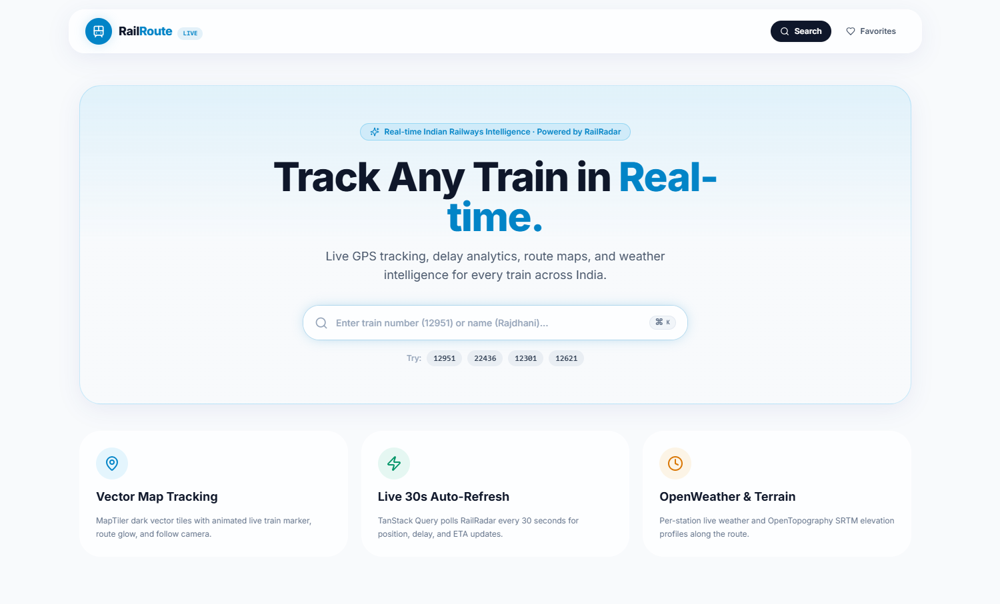
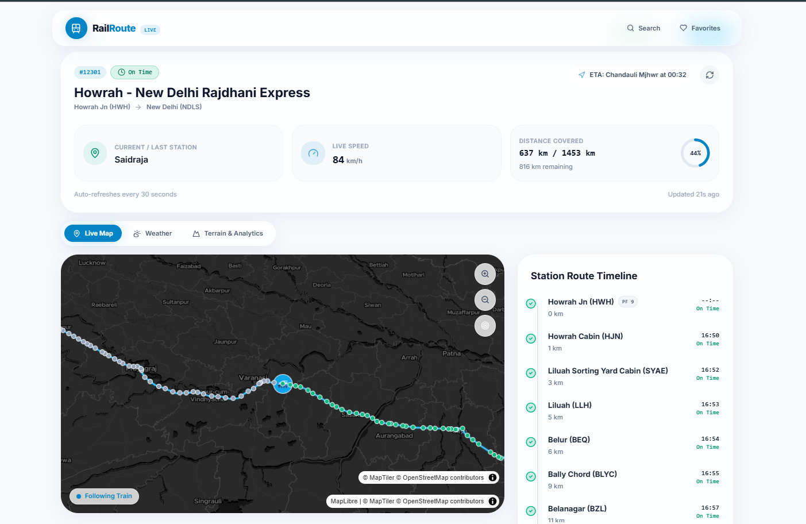
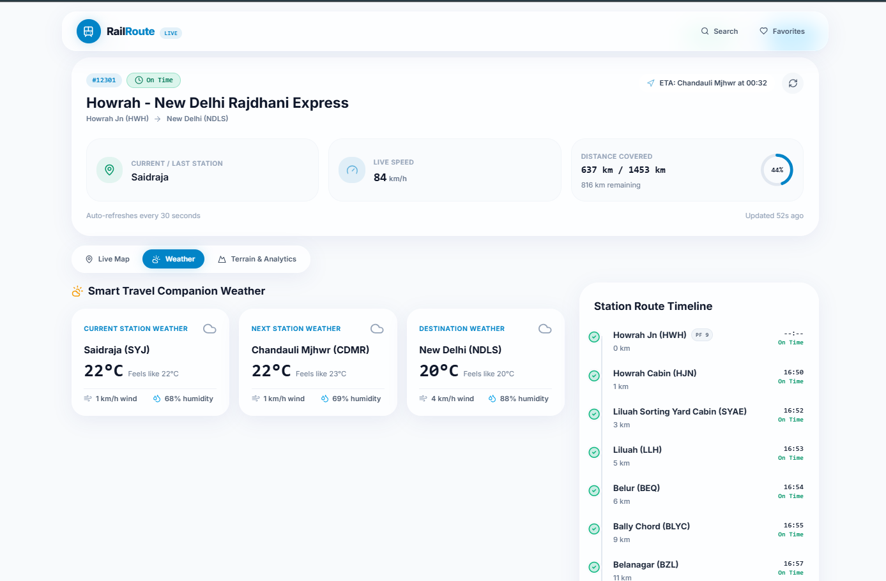
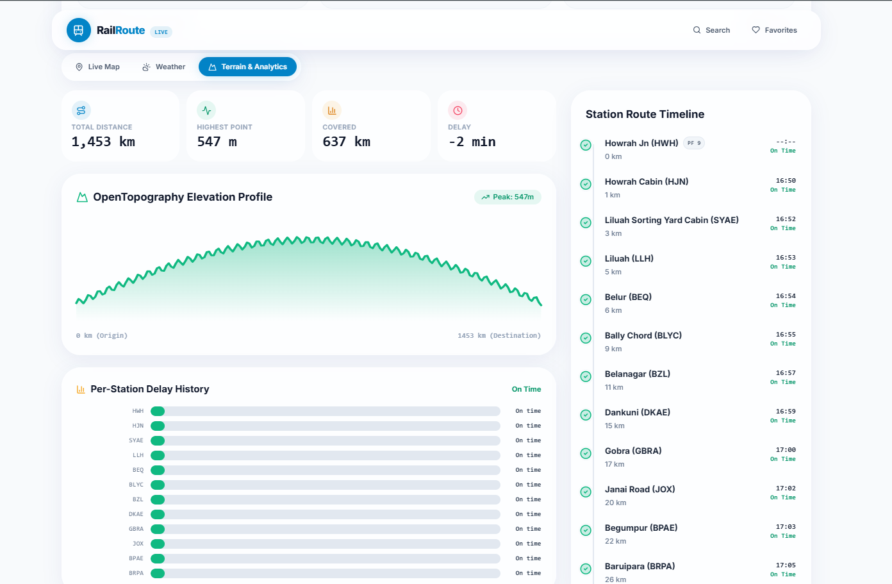

# 🚆 RailRoute — Live Indian Train Tracker

**RailRoute** is a modern, full-stack web application for tracking Indian trains in real time. It combines live train status, interactive maps, train search, weather information, terrain data, and a clean user interface to provide a convenient railway tracking experience.

🌐 **Live Demo:** [https://railroute-tau.vercel.app/](https://railroute-tau.vercel.app/)

---

## 📸 Screenshots

Explore the RailRoute interface through the screenshots below.

<table>
  <tr>
    <td align="center">
      
      <br>
      <b>RailRoute Preview 1</b>
    </td>
    <td align="center">
      
      <br>
      <b>RailRoute Preview 2</b>
    </td>
  </tr>
  <tr>
    <td align="center">
      
      <br>
      <b>RailRoute Preview 3</b>
    </td>
    <td align="center">
      
      <br>
      <b>RailRoute Preview 4</b>
    </td>
  </tr>
</table>

---

## ✨ Features

- **Live Train Tracking:** Track train locations and view available live status information.
- **Interactive Maps:** Explore train locations and routes using MapLibre-based vector maps.
- **Fast Train Search:** Search for trains using the available train database, including offline search functionality.
- **Weather Information:** Access weather information for relevant locations and stations.
- **Terrain and Elevation:** Explore terrain data and elevation information where supported.
- **Points of Interest:** View nearby points of interest using map data integrations.
- **Favorites:** Save preferred trains for convenient access.
- **Responsive Interface:** Use the application across desktop and mobile screen sizes.
- **Data Caching:** Reduce unnecessary API requests through caching.
- **Fallback Mode:** Maintain access to supported functionality when live data services are unavailable.

> **Note:** Live tracking accuracy and data availability depend on the upstream API providers and their current service status.

---

## 🛠️ Tech Stack

| Technology | Purpose |
|---|---|
| Next.js 14 | React framework and application routing |
| TypeScript 5.5 | Type-safe application development |
| Tailwind CSS 3.4 | Utility-first styling |
| Framer Motion | UI animations and transitions |
| Lucide | Icons |
| Zustand | Client-side state management |
| TanStack Query | Server-state management and data fetching |
| MapLibre GL | Interactive maps |
| RailRadar API | Railway-related data integration |
| MapTiler | Map tiles and map services, where configured |
| OpenWeather API | Weather information |
| OpenTopography API | Terrain and elevation data |
| Overpass API | Points-of-interest and map data |
| Upstash Redis | Optional caching infrastructure |

---

## 🏗️ System Architecture

RailRoute uses a Next.js application architecture in which the frontend communicates with API routes that integrate external data providers.

```text
                    ┌────────────────────────┐
                    │       User / Browser   │
                    └────────────┬───────────┘
                                 │
                                 ▼
                    ┌────────────────────────┐
                    │   Next.js Frontend     │
                    │ TypeScript + Tailwind  │
                    └────────────┬───────────┘
                                 │
                                 ▼
                    ┌────────────────────────┐
                    │   Next.js API Routes   │
                    │                        │
                    │ Train / Weather /      │
                    │ Terrain / Analytics    │
                    └────────────┬───────────┘
                                 │
              ┌──────────────────┼──────────────────┐
              │                  │                  │
              ▼                  ▼                  ▼
       ┌─────────────┐   ┌──────────────┐   ┌──────────────┐
       │ RailRadar   │   │ OpenWeather  │   │ OpenTopo /   │
       │ API         │   │ API          │   │ Overpass     │
       └─────────────┘   └──────────────┘   └──────────────┘
                                 │
                                 ▼
                    ┌────────────────────────┐
                    │ Optional Redis Cache   │
                    │      Upstash           │
                    └────────────────────────┘
```

*The diagram illustrates the high-level design. Actual request flows and integrations depend on the project's implementation and environment configuration.*

---

## 📁 Project Structure

The following is a reference structure for navigating the codebase. Some folders or route names may differ depending on your current implementation.

```text
RailRoute/
├── app/
│   ├── api/
│   │   ├── analytics/
│   │   │   └── [id]/
│   │   ├── search/
│   │   ├── terrain/
│   │   ├── train/
│   │   │   └── [id]/
│   │   ├── weather/
│   │   └── favorites/
│   ├── layout.tsx
│   ├── page.tsx
│   └── globals.css
│
├── components/
│   ├── map/
│   ├── train/
│   ├── search/
│   ├── weather/
│   └── ui/
│
├── config/
│
├── features/
│
├── hooks/
│
├── lib/
│   ├── api/
│   ├── cache/
│   └── utils/
│
├── store/
│
├── styles/
│
├── types/
│
├── utils/
│
├── public/
│   └── assets/
│
├── screenshots/
│   ├── RailRoute_Preview1.png
│   ├── RailRoute_Preview2.png
│   ├── RailRoute_Preview3.png
│   └── RailRoute_Preview4.png
│
├── .env.example
├── .gitignore
├── next.config.js
├── package.json
├── postcss.config.js
├── tailwind.config.ts
├── tsconfig.json
└── README.md
```

**Important:** Adjust this tree to match your actual repository. The screenshot paths in this README assume the images are stored in the repository root. If you keep them in `screenshots/`, update the image paths to `./screenshots/RailRoute_Preview1.png` and similarly for the other three images.

---

## 🚀 Getting Started

Follow these steps to run RailRoute locally.

### Prerequisites

Make sure you have the following installed:

- [Node.js](https://nodejs.org/) — version 18.17 or newer; Node.js 20 or 22 is recommended.
- npm, which comes with Node.js.
- Git, to clone the repository.

### 1. Clone the repository

Replace `YOUR_GITHUB_USERNAME` with your GitHub username or organization name.

```bash
git clone https://github.com/YOUR_GITHUB_USERNAME/RailRoute.git
```

Move into the project directory:

```bash
cd RailRoute
```

### 2. Install dependencies

```bash
npm install
```

### 3. Configure environment variables

Check whether the project includes an `.env.example` file. If it does, create a local environment file from it.

**Windows Command Prompt:**

```cmd
copy .env.example .env.local
```

**PowerShell:**

```powershell
Copy-Item .env.example .env.local
```

Open `.env.local` and add the API keys required by your implementation.

Example:

```env
# Railway data
RAILRADAR_API_KEY=

# Map services
NEXT_PUBLIC_MAPTILER_API_KEY=

# Weather data
OPENWEATHER_API_KEY=

# Optional caching
UPSTASH_REDIS_REST_URL=
UPSTASH_REDIS_REST_TOKEN=

# Optional terrain service
OPENTOPOGRAPHY_API_KEY=
```

**Important:** These names are examples, not a guarantee of the exact environment variables used by your code. Check your API clients and `.env.example` file, then use the exact variable names expected by your project. Remove variables for services you do not use.

Never commit `.env.local` or expose private API keys in client-side code or your public repository. Variables prefixed with `NEXT_PUBLIC_` are exposed to the browser.

### 4. Start the development server

```bash
npm run dev
```

Open the application in your browser:

[http://localhost:3000](http://localhost:3000)

The development server supports hot reloading, so most code changes appear automatically.

### 5. Create a production build

To check whether the project builds successfully:

```bash
npm run build
```

To run the production build locally:

```bash
npm run start
```

---

## 🔌 API Integrations

RailRoute can integrate multiple external services to provide railway, mapping, weather, and geographic information.

| Service | Purpose |
|---|---|
| RailRadar | Train-related data and live status, where available |
| MapTiler | Map tiles and related mapping services, if configured |
| OpenWeather | Weather information |
| OpenTopography | Elevation and terrain data |
| Overpass API | Geographic data and points of interest |
| Upstash Redis | Optional server-side caching |

Availability, rate limits, authentication requirements, and response formats depend on each provider.

---

## ⚡ Caching Strategy

Caching can reduce repeated requests, improve responsiveness, and help manage third-party API usage.

The project's intended caching intervals are:

| Data type | Intended cache duration |
|---|---|
| Live train status | 30 seconds |
| Weather information | 15 minutes |
| Terrain and elevation | 24 hours |

These intervals describe the intended configuration and should be verified against the actual cache implementation. Live train data may require shorter caching periods to remain useful.

---

## 🧭 Application Modules

### Train Search and Tracking
Search for supported trains and access available train status and location information.

### Interactive Map
Explore geographic information using MapLibre and the configured map data provider.

### Weather
Retrieve weather information through the configured weather service.

### Terrain and Points of Interest
Access available elevation, terrain, and geographic points-of-interest data.

### Favorites
Save preferred trains using the application's state-management and persistence implementation.

### Fallback Support
Use supported fallback functionality when external data providers are unavailable. Fallback behavior depends on the services and data available to the application.

---

## 📜 Available Scripts

The following scripts are common in a Next.js project. Check the `scripts` section of your `package.json` for the commands actually supported by your repository.

| Command | Description |
|---|---|
| `npm run dev` | Starts the development server |
| `npm run build` | Creates a production build |
| `npm run start` | Starts the production server |
| `npm run lint` | Runs the configured linting command, if available |

---

## ☁️ Deployment

RailRoute is deployed on Vercel.

**Live application:** [https://railroute-tau.vercel.app/](https://railroute-tau.vercel.app/)

To deploy your own copy:

1. Push the project to a GitHub repository.
2. Import the repository into [Vercel](https://vercel.com/).
3. Configure the required environment variables in the Vercel project settings.
4. Deploy the application.
5. Verify the live train data, maps, and other API integrations.

Keep server-side API keys in server-side environment variables. Only expose a key through a `NEXT_PUBLIC_` variable when the provider explicitly supports public client-side use.

---

## 🔒 Security and Reliability

- Keep private API credentials out of source control.
- Store local secrets in `.env.local`.
- Configure production environment variables in your deployment platform.
- Handle API errors and rate limits gracefully.
- Validate and sanitize user input in API routes.
- Use caching thoughtfully, especially for frequently changing train information.
- Avoid presenting stale or unavailable data as confirmed live information.

---

## 🧑‍💻 Development Workflow

A suggested workflow for contributing to RailRoute:

1. Clone the repository.
2. Install dependencies.
3. Configure the required environment variables.
4. Run the development server.
5. Make and test changes locally.
6. Run the production build.
7. Commit and push your changes.

---

## 🗺️ Future Improvements

Potential enhancements include:

- More detailed train arrival and departure predictions.
- Improved route visualization and station-level information.
- Additional train filters and search options.
- Better handling of unavailable or delayed API responses.
- Accessibility improvements and additional responsive UI refinements.
- Expanded automated testing and API integration tests.

*These are possible future enhancements, not claims about features currently implemented.*

---

## 📄 License

This project is intended to use the MIT License. Ensure that an MIT `LICENSE` file exists in the repository before presenting the project as officially licensed under MIT.

---

## 👨‍💻 Author

**RailRoute** — Live Indian Train Tracker

🌐 **Live Demo:** [railroute-tau.vercel.app](https://railroute-tau.vercel.app/)

If you find the project useful, consider giving the repository a ⭐ on GitHub.

---

*Built with Next.js, TypeScript, and modern web technologies.*